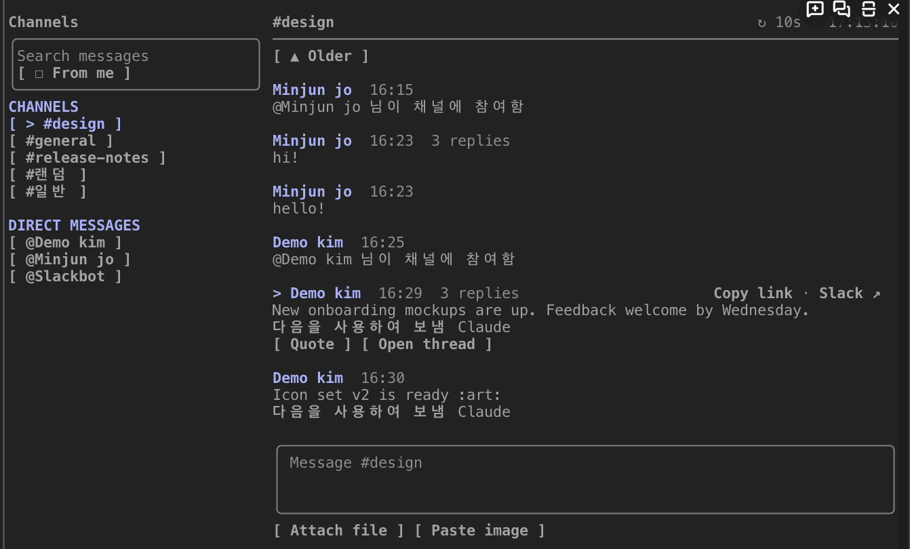
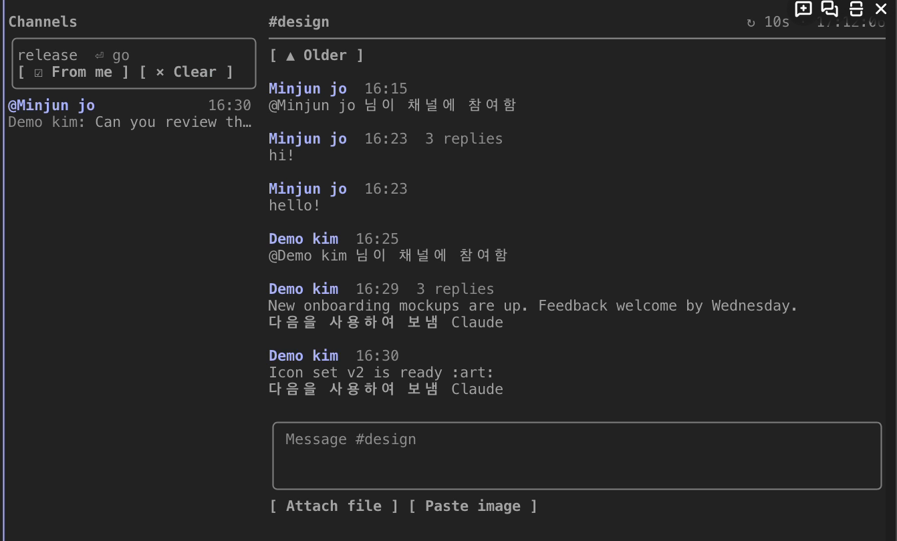
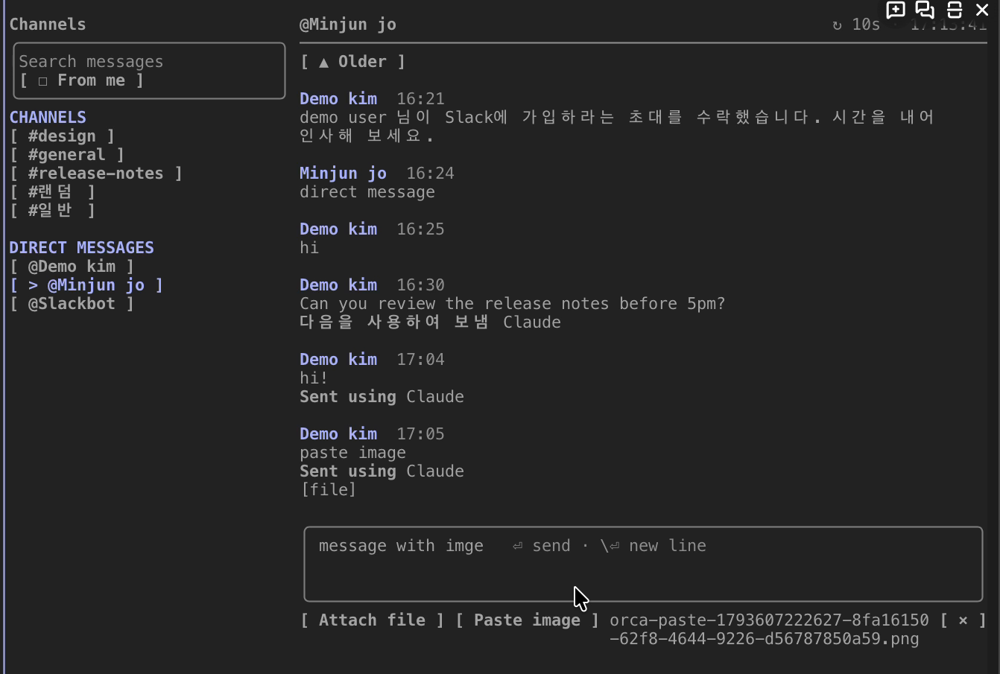
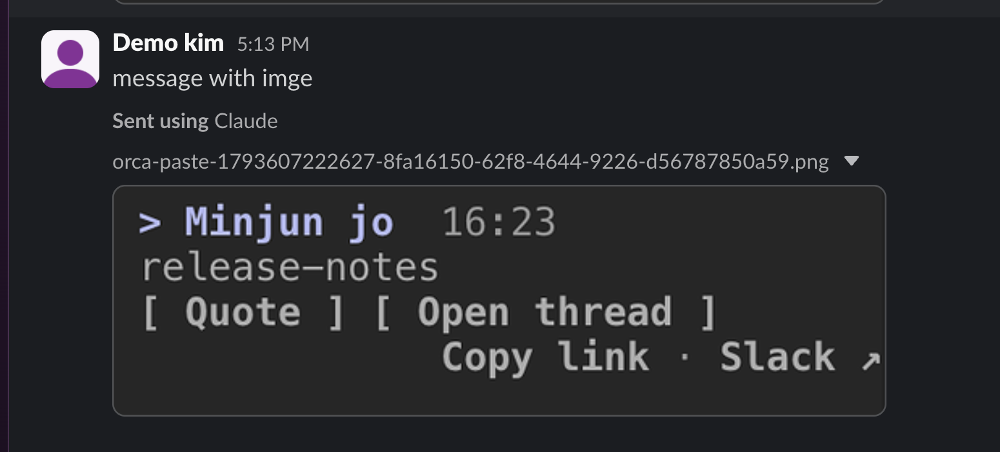
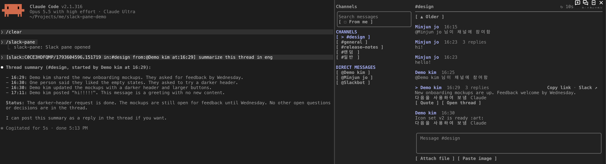

# slack-pane

[English](README.md) | 한국어

slack-pane은 Claude Code 대화 옆의 pane에 Slack을 띄우는 mod다. mod는 Claude Code의 화면과 동작을 바꾸는 플러그인이다. pane은 대화 옆에 따로 그려지는 화면 영역이다.

사용자는 터미널을 벗어나지 않고 다음 일을 할 수 있다.

- 채널과 스레드를 읽는다.
- 메시지와 이미지를 보낸다.
- Slack 메시지를 스레드와 함께 다음 프롬프트에 인용한다. Claude는 인용한 스레드를 읽는다.

slack-pane은 Claude Code에 연결된 Slack MCP 서버로 Slack과 통신한다. Slack MCP 서버는 Claude Code가 Slack을 읽고 쓸 때 쓰는 서버다. 그래서 slack-pane에는 별도의 Slack 앱이나 토큰이 필요 없다.



## 기능

- **두 열.** 왼쪽 열은 내가 속한 채널, 비공개 채널, DM, 그룹 DM을 보여 준다. 왼쪽 열은 채널을 먼저, DM을 나중에 보여 준다. 두 목록은 각각 이름순이다. 열린 채널에는 `>`와 강조색이 붙는다. 메시지 검색창도 왼쪽 열에 있다. 오른쪽 열은 열린 채널이나 스레드를 보여 준다.
- **열별 스크롤.** 두 열은 따로 스크롤된다. 마우스 휠은 포인터 아래의 열을 움직인다. 스크롤 키는 오른쪽 열의 메시지를 움직인다. 위로 스크롤한 동안에는 새 메시지가 와도 화면이 움직이지 않는다. 메시지 입력창 위의 `▼ Latest · N newer`를 누르면 화면이 최신 메시지로 돌아간다. 그 뒤로 화면은 다시 새 메시지를 따라간다.
- **검색.** 검색창에 검색어를 입력하고 Enter를 누르면 검색이 시작된다. 검색어에는 Slack 검색 문법(`in:`, `from:`, `after:`)을 쓸 수 있다. `☐ From me` 필터를 켜면(`☑`) 검색은 내 메시지만 찾는다. 이 필터는 검색어 없이도 쓸 수 있다.
- **검색 결과.** 결과는 첫 줄에 채널과 시간을, 둘째 줄에 작성자와 본문을 보여 준다. 결과를 누르면 그 메시지의 스레드가 열린다. 스레드에서 `← #channel`을 누르면 채널의 그 메시지 위치가 열린다.

  

- **Slack 서식.** `*굵게*`, `_기울임_`, `~취소선~`, `` `코드` ``, 코드 블록, `>` 인용은 기호 없이 스타일로 그려진다. 사람 멘션은 이름으로 표시된다.
- **실시간 보기.** slack-pane은 열린 채널이나 스레드만 다시 읽는다. 기본 주기는 10초다. 오른쪽 열의 열 머리글(열 맨 위 줄)은 새로고침 상태(`↻ 10s · 14:05:12`, `↻ updating…`, `⏸ paused`, `⚠ failed …`)를 보여 준다.
- **보내기.** 메시지 입력창이 비어 있으면 메시지 입력창은 메시지가 갈 곳(`Message #general`, `Reply in thread · #general`)을 보여 준다. Enter를 누르면 slack-pane은 메시지를 바로 보낸다.
- **이미지.** `Attach file`은 파일 경로를 받는다. 파일을 터미널로 끌어다 놓으면 터미널이 경로를 입력한다. `Paste image`는 클립보드의 이미지를 첨부한다(macOS 전용). 메시지 입력창의 경로가 실제 이미지 파일을 가리키면 slack-pane은 그 경로를 글에서 빼고 첨부로 바꾼다. 대상은 `/…` 또는 `~/…`로 시작하는 png, jpg, gif, webp 파일이다. 그래서 클립보드 이미지를 임시 파일 경로로 붙여넣는 터미널에서도 이미지가 첨부된다.

  

  

- **Claude에 인용.** 메시지를 누르면 메시지가 선택된다. 선택한 메시지를 다시 누르면 선택이 풀린다. 선택한 메시지에서 `Quote`를 누르면 프롬프트 입력창에 짧은 인용 표시가 들어간다. 프롬프트를 보내면 slack-pane은 그 메시지의 스레드 전체를 맥락으로 붙인다. slack-pane은 인용한 메시지 줄에 `▶`를 붙인다. slack-pane은 인용한 내용을 신뢰할 수 없는 데이터로 표시한다.

  

- **Copy link · Slack ↗.** 두 버튼은 선택한 메시지의 메시지 머리글(작성자와 시간이 있는 줄) 오른쪽에 있다. 열이 좁으면 두 버튼은 동작 버튼 줄로 옮겨진다. `Copy link`는 메시지의 Slack 링크를 복사한다. `Slack ↗`는 Slack에서 그 메시지를 연다(macOS `open`). 메시지 수정과 삭제는 Slack에서 한다. Slack MCP는 수정과 삭제를 지원하지 않는다.

## 요구 사항

- Claude Code 2.1.316 이상.
- Slack MCP 서버 연결. 서버는 `/mcp` 목록에 보여야 한다. 기본 이름은 `plugin:slack:slack`이다.
- 대화 옆에 pane을 두려면 전체 화면 모드와 110열 이상의 터미널이 필요하다. 터미널이 더 좁으면 pane은 프롬프트 위에 놓인다.
- 이미지 업로드에는 `curl`이 필요하다.
- `Paste image`에는 `osascript`(macOS)가 필요하다.

## 설치

```
/plugin install slack-pane --marketplace jo-minjun/claude-slack-pane
```

Claude Code가 마켓플레이스를 추가할지 물으면 `y`로 답한다. 그다음 설치 범위를 고른다.

저장소를 직접 받아 실행하려면 다음 명령을 쓴다.

```
claude --plugin-dir /path/to/claude-slack-pane
```

## 명령어

| 명령어 | 동작 |
| --- | --- |
| `/slack-pane [#channel \| @user \| channel ID \| message link]` | 인자가 없으면 pane을 열거나 닫는다. 채널이나 DM을 주면 그 채널이나 DM으로 pane을 연다. Slack 메시지 링크를 주면 채널의 그 메시지 위치를 연다. 링크가 답글을 가리키면 그 스레드를 연다. |
| `/slack-pane-refresh [seconds]` | 인자가 없으면 새로고침 주기를 보여 준다. 초를 주면 새로고침 주기를 정한다(5–300초). 정한 값은 세션이 바뀌어도 유지된다. |
| `/slack-pane-search <query>` | pane을 열고 메시지를 검색한다. |

## 설정

| 옵션 | 기본값 | 뜻 |
| --- | --- | --- |
| `mcpServer` | `plugin:slack:slack` | `/mcp` 목록에 보이는 Slack MCP 서버 이름. |

## 제한 사항

- Slack MCP는 사람이 읽는 형식의 글을 돌려준다. slack-pane은 이 글을 해석한다. 글 형식이 바뀌면 해석이 실패할 수 있다. 해석이 실패하면 pane에 `Unrecognized Slack response`가 표시된다. 이때 디버그 로그(`claude --debug`)에 응답의 앞부분이 남는다.
- slack-pane은 읽지 않음 표시, 이모지 그림, 반응(reaction)을 보여 주지 않는다.
- 사람 멘션은 Slack이 함께 보낸 이름으로 표시된다. 그룹 멘션과 이름 없이 온 사람 멘션은 ID(`@subteam^S…`, `@U…`)로 표시된다. Slack MCP는 그룹 이름을 조회할 수 없다.
- 메시지 입력창과 검색창은 칸보다 긴 줄을 `…`로 자른다. 두 입력창은 긴 줄을 줄바꿈하지 않는다. 커서가 칸 밖에 보일 수도 있다. slack-pane은 Claude Code의 입력창 요소를 쓰므로 이 동작을 바꿀 수 없다.
- pane에서는 메시지를 수정하거나 삭제할 수 없다. `Slack ↗`를 누르면 Slack에서 그 메시지가 열린다.
- 주의: Enter를 누르기 전에 열 머리글의 채널 이름을 확인한다. slack-pane은 확인 단계 없이 메시지를 바로 보낸다.

## 개발

```
claude plugin validate .
claude plugin test .
```

`tsconfig.json`은 `.claude-plugin/types/`의 타입을 확장한다. Claude Code는 mod를 처음 불러올 때 이 폴더에 타입을 쓴다. 그래서 `tsc -p .`는 `claude --plugin-dir .` 세션을 한 번 연 뒤에 실행한다.

## 라이선스

MIT
