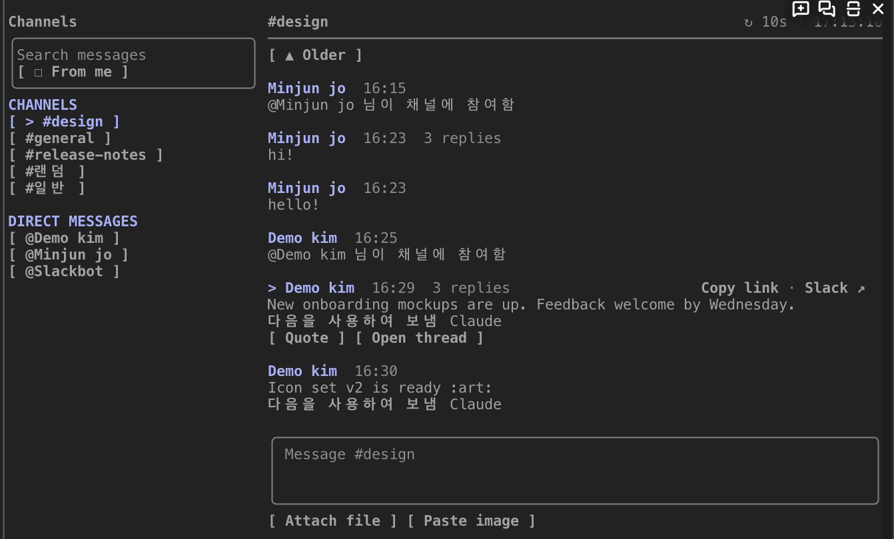
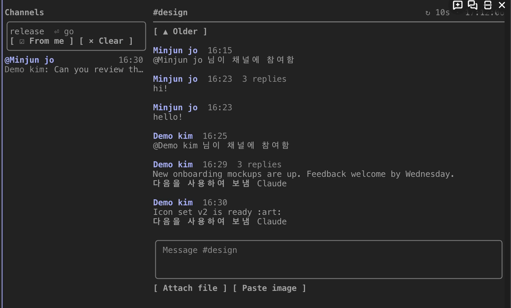
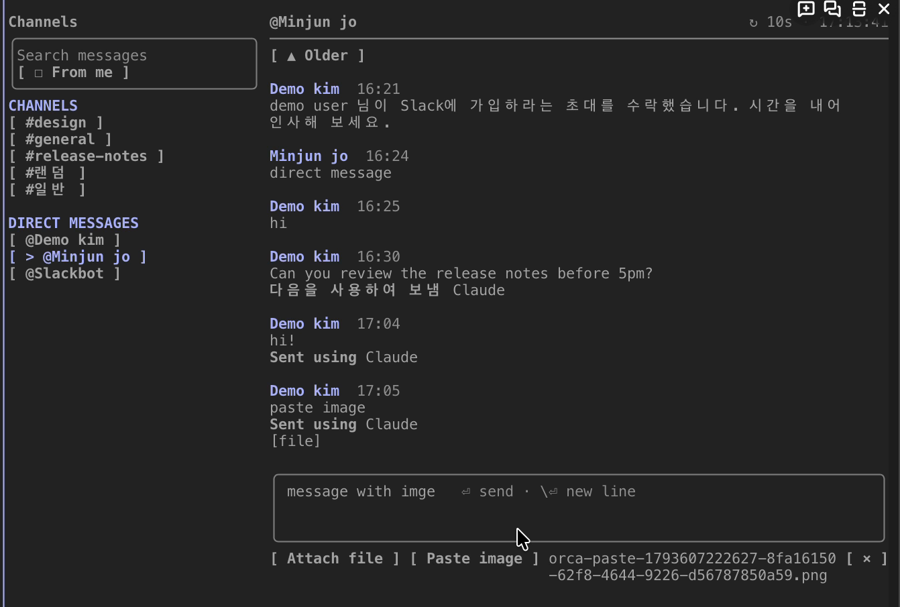
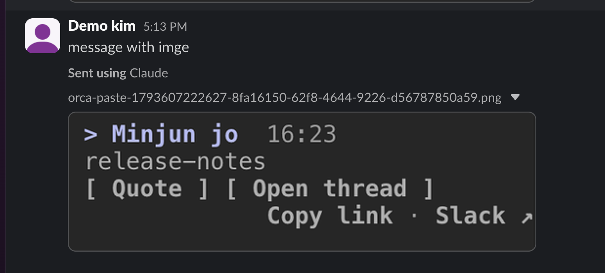
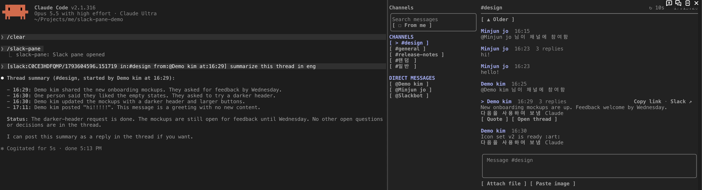

# slack-pane

English | [한국어](README.ko.md)

slack-pane is a Claude Code mod that shows Slack in a pane beside the conversation. A mod is a plugin that changes how Claude Code looks and works. A pane is a screen area that Claude Code draws apart from the conversation.

You can do these things without leaving the terminal:

- Read channels and threads.
- Send messages and images.
- Quote a Slack message, with its thread, into your next prompt. Claude reads the quoted thread.

slack-pane talks to Slack through the Slack MCP server connected to Claude Code. The Slack MCP server is the server that Claude Code uses to read and write Slack. Because of this, slack-pane needs no Slack app and no token of its own.



## Features

- **Two columns.** The left column shows every channel, private channel, DM and group DM you are in. The left column shows channels first and DMs second. Each list is sorted by name. The open channel has a `>` mark and the accent color. The message search box is also in the left column. The right column shows the open channel or thread.
- **Separate scrolling.** The two columns scroll separately. The mouse wheel moves the column under the pointer. The scroll keys move the messages in the right column. While you are scrolled up, new messages do not move the view. When you press `▼ Latest · N newer` above the message input, the view goes back to the newest message. After that, the view follows new messages again.
- **Search.** When you type a query in the search box and press Enter, the search starts. A query can use Slack search modifiers (`in:`, `from:`, `after:`). When you turn on the `☐ From me` filter (`☑`), the search finds only your own messages. You can use this filter without a query.
- **Search results.** Each result shows its channel and time on the first line. Each result shows its author and text on the second line. When you press a result, the message's thread opens. When you press `← #channel` in the thread, the channel opens at the message.

  

- **Slack formatting.** slack-pane draws `*bold*`, `_italic_`, `~strike~`, `` `code` ``, code blocks and `>` quotes as styles, without their markers. A user mention shows the user's name.
- **Live view.** slack-pane re-reads only the open channel or thread. The default interval is 10 seconds. The column header (the top line of the right column) shows the refresh state (`↻ 10s · 14:05:12`, `↻ updating…`, `⏸ paused`, `⚠ failed …`).
- **Send.** When the message input is empty, the message input shows where a message goes (`Message #general`, `Reply in thread · #general`). When you press Enter, slack-pane sends the message at once.
- **Mentions.** When the message input ends in `@` and part of a name, candidate buttons appear under the message input. When you press a candidate, the `@query` in the message input becomes `<@USER_ID>`. Slack takes this form as a mention. The sent message shows as `@name` in the pane's message list.
- **Mention candidates.** The candidate list shows the authors of the open channel or thread first and Slack user search results second. The author candidates leave you out. A Korean syllable reaches the message input only when its composing ends. Because of this, when you press Space after the last syllable, the search includes that syllable and the candidate buttons stay.
- **Images.** `Attach file` takes a file path. When you drag a file onto the terminal, the terminal types its path. `Paste image` attaches the image on the clipboard (macOS only). When a path in the message input points to an existing image file, slack-pane removes the path from the text and attaches the file. This applies to png, jpg, gif and webp files whose path starts with `/…` or `~/…`. Because of this, an image is attached even in a terminal that pastes a clipboard image as a temporary file's path.

  

  

- **Quote into Claude.** When you press a message, the message is selected. When you press the selected message again, the selection is removed. When you press `Quote` on the selected message, a short quote reference goes into the prompt input. When you send the prompt, slack-pane attaches the message's whole thread as context. slack-pane marks the quoted message's line with `▶`. slack-pane marks the quoted text as untrusted data.

  

- **Copy link · Slack ↗.** The two buttons are at the right of the selected message's message header (the line with the author and time). When the column is narrow, the two buttons move to the action button row. `Copy link` copies the message's Slack link. `Slack ↗` opens the message in Slack (macOS `open`). You edit or delete a message in Slack. The Slack MCP does not support editing or deleting.

## Requirements

- Claude Code 2.1.316 or later.
- A connected Slack MCP server. `/mcp` must list the server. The default name is `plugin:slack:slack`.
- For the pane beside the conversation, you need fullscreen mode and a terminal at least 110 columns wide. When the terminal is narrower, the pane sits above the prompt.
- Image upload needs `curl`.
- `Paste image` needs `osascript` (macOS).

## Install

```
/plugin install slack-pane --marketplace jo-minjun/claude-slack-pane
```

When Claude Code asks whether to add the marketplace, answer `y`. Then pick a scope.

To run slack-pane from a clone instead, use this command:

```
claude --plugin-dir /path/to/claude-slack-pane
```

## Commands

| Command | What it does |
| --- | --- |
| `/slack-pane [#channel \| @user \| channel ID \| message link]` | Without an argument, it opens or closes the pane. With a channel or DM, it opens the pane on that channel or DM. With a Slack message link, it opens the channel at the message. When the link points to a reply, it opens the reply's thread. |
| `/slack-pane-refresh [seconds]` | Without an argument, it shows the refresh interval. With seconds, it sets the refresh interval (5–300 seconds). The value is kept across sessions. |
| `/slack-pane-search <query>` | It opens the pane and searches messages. |

## Settings

| Option | Default | Meaning |
| --- | --- | --- |
| `mcpServer` | `plugin:slack:slack` | The Slack MCP server's name as `/mcp` lists it. |

## Limits

- The Slack MCP returns human-readable text. slack-pane parses this text. When the text format changes, parsing can fail. When parsing fails, the pane shows `Unrecognized Slack response`. The debug log (`claude --debug`) then holds the start of the response.
- slack-pane does not show unread markers, emoji images or reactions.
- A user mention shows the name that Slack sends with it. A user-group mention, or a user mention sent without a name, shows its ID (`@subteam^S…`, `@U…`). The Slack MCP cannot look up group names.
- The message input and the search box cut a line longer than the field with `…`. The two inputs do not wrap long lines. The cursor can show past the field. slack-pane uses Claude Code's input element, so slack-pane cannot change this behavior.
- slack-pane reads only an `@query` at the end of the message input. Claude Code's input does not tell the cursor position. An `@name` you type yourself goes as plain text, not as a mention. A `<@USER_ID>` you type yourself goes as a mention.
- You cannot edit or delete messages in the pane. When you press `Slack ↗`, the message opens in Slack.
- Caution: Check the channel name in the column header before you press Enter. slack-pane sends a message at once, with no confirmation step.

## Development

```
claude plugin validate .
claude plugin test .
```

`tsconfig.json` extends the types in `.claude-plugin/types/`. Claude Code writes the types into this folder when it first loads the mod. Because of this, run `tsc -p .` after you open one `claude --plugin-dir .` session.

## License

MIT
